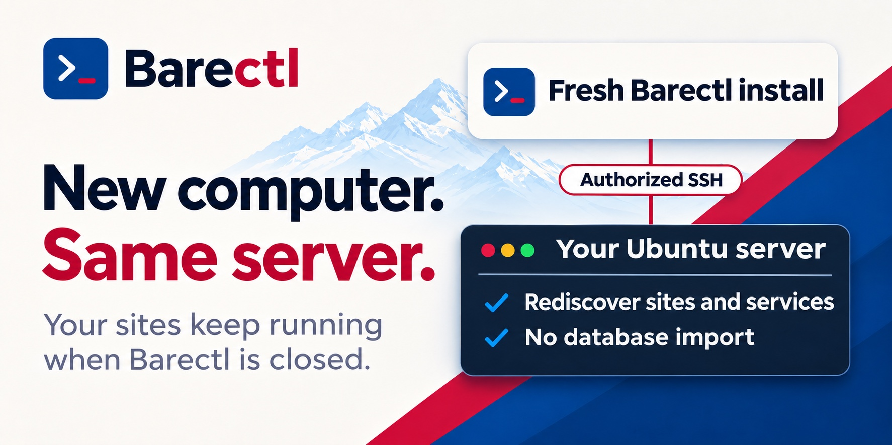

# Barectl

**Lose the dashboard? Reconnect and keep managing your server.**

Barectl is an open-source hosting panel for PHP, WordPress, and Laravel. If you switch computers or lose the Barectl database, install a fresh copy and connect over SSH. Barectl rediscovers supported sites and services directly from your server, without a database import or a server-side agent. Your sites and scheduled jobs keep running while the dashboard is closed.



[Run Barectl locally](#run-locally) · [See how recovery is tested](docs/recovery-guarantees.md#matrix)

**Latest release** · [v1.0.1](https://github.com/rajandangi/barectl/releases/tag/v1.0.1)

## Current status

Barectl supports fresh Ubuntu 26.04 LTS servers on amd64 and arm64, and servers already set up on the supported Barectl stack. Existing Nginx, APT PHP, and hosting-panel servers are read-only in Barectl. [Server requirements](docs/bootstrap.md#prerequisites) · [Stack and architecture](docs/target-architecture.md#stack)

- Create PHP, WordPress, and Laravel sites. Choose PHP and Node.js versions, add a MariaDB or PostgreSQL database, and deploy or roll back Laravel releases.
- Run Laravel queues and schedulers, WordPress cron, and per-site Valkey. Inspect logs, server jobs, and security settings.
- Schedule encrypted restic backups, copy them to S3-compatible storage, and restore site files or databases.

The [v1.0 qualification record](docs/v1.0-qualification.md) describes the tested environments and recovery procedures. The [v1.0.1 record](docs/v1.0.1-qualification.md) covers this patch.

## Run locally

Use [uv](https://docs.astral.sh/uv/getting-started/installation/), Python 3.14, and Node.js 24. The commands below run the development branch. For a stable install, add `--branch v1.0.1` to `git clone`.

```bash
git clone https://github.com/rajandangi/barectl.git
cd barectl
uv sync --locked
npm ci
npm run build
cp .env.example .env
uv run --env-file .env python manage.py migrate
uv run --env-file .env python manage.py createsuperuser
uv run --env-file .env python manage.py runserver 127.0.0.1:8000
```

Start the worker in a second terminal from the same checkout.

```bash
uv run --env-file .env python manage.py db_worker
```

Open <http://127.0.0.1:8000>, sign in, and choose **Add server**. [Host your first PHP site](docs/first-site.md)

## Core philosophy

The managed server is the source of truth. Barectl reads ordinary Linux configuration, service state, and logs. Accounts, saved connections, and private operation history stay in the original installation's local database. SSH credentials stay on the computer running Barectl. [Architecture](docs/architecture.md#state-and-discovery) · [Native recovery](docs/recovery.md)

## Documentation

- [Operator handbook](https://github.com/rajandangi/barectl/wiki) · [Hosting notes](docs/hosting.md) · [Dashboard workflows](docs/dashboard-workflows.md)
- [Roadmap](ROADMAP.md) · [Changelog](CHANGELOG.md) · [Releases](https://github.com/rajandangi/barectl/releases)
- [Contributing](CONTRIBUTING.md) · [Development checks](docs/quality.md#local-commands) · [Security reporting](SECURITY.md)

### Operator accounts

See [operator accounts](docs/operator-accounts.md) for password recovery, roles, and permissions.

[Apache License 2.0](LICENSE)
